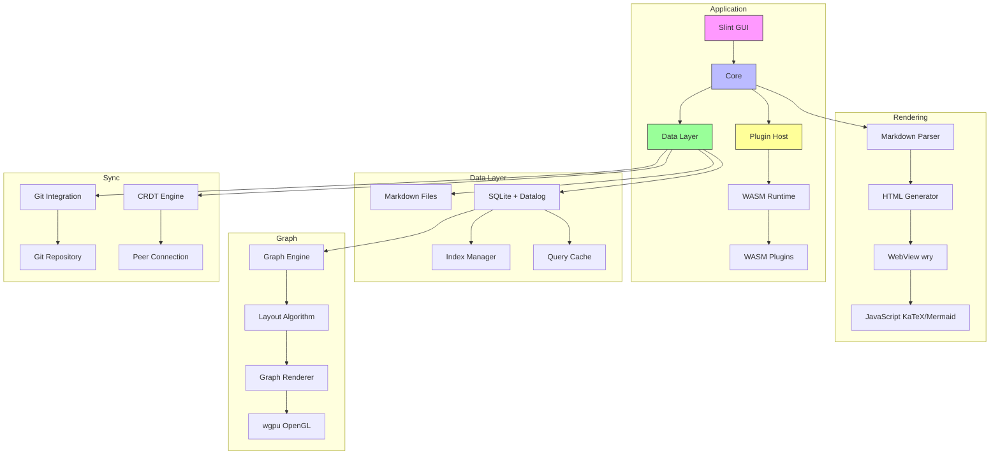

# Architecture Technique - Alternative Logseq/Obsidian en Rust

**Date:** 2024  
**Projet:** Alternative 100% Rust à Logseq/Obsidian  
**Plateformes:** Desktop macOS, Windows, Linux  
**Contraintes:** 100% Rust, pas de runtime externe sans validation, optimisation simplicité et performance

---

## Table des Matières

1. [Contexte et Objectifs](#contexte-et-objectifs)
2. [Architecture Globale](#architecture-globale)
3. [Décisions Techniques par Domaine](#décisions-techniques-par-domaine)
   - [3.1 Framework GUI](#31-framework-gui)
   - [3.2 Stockage des Données](#32-stockage-des-données)
   - [3.3 Rendu Markdown](#33-rendu-markdown)
   - [3.4 Graphe de Connaissances](#34-graphe-de-connaissances)
   - [3.5 Synchronisation](#35-synchronisation)
   - [3.6 Système de Plugins](#36-système-de-plugins)
   - [3.7 Optimisation des Performances](#37-optimisation-des-performances)
4. [Diagramme d'Architecture](#diagramme-darchitecture)
5. [Roadmap Technique](#roadmap-technique)
6. [Références et Sources](#références-et-sources)

---

## Contexte et Objectifs

### Objectifs Principaux
- Créer une alternative 100% Rust à Logseq/Obsidian
- Supporter toutes les fonctionnalités de Logseq + compatibilité Obsidian
- Multiplateforme : macOS, Windows, Linux
- Stockage local en Markdown + base de données optimisée
- Performances élevées pour les grands graphes de connaissances (>10,000 nœuds)

### Contraintes
- **100% Rust** : Pas de dépendances externes non-Rust sans validation explicite
- **Compatibilité** : Fichiers Markdown compatibles Obsidian/Logseq
- **Performance** : Optimisé pour les grands graphes
- **Simplicité** : Architecture maintenable et extensible

---

## Architecture Globale

```
┌─────────────────────────────────────────────────────────────────────────┐
│                         APPLICATION PRINCIPALE                          │
├─────────────────────────────────────────────────────────────────────────┤
│  ┌──────────────┐    ┌──────────────┐    ┌──────────────┐              │
│  │   GUI Layer  │    │  Core Layer  │    │ Data Layer   │              │
│  │    (Slint)   │◄──►│   (Rust)     │◄──►│   (SQLite)   │              │
│  └──────────────┘    └──────────────┘    └──────────────┘              │
│           ▲                    ▲  ▲  ▲                    ▲              │
│           │                    │  │  └──────────┐         │              │
│           │                    │  └─────►WASM◄──┘         │              │
│           │                    │        (Plugins)         │              │
└─────────────────────────┬─────────────────────────────────────────────┘
                              │
                              ▼
                      ┌─────────────────┐
                      │   WebView (wry) │
                      │ Markdown Render │
                      └─────────────────┘
                              ▲          ▲
                    ┌─────────┴─────┐ ┌─┴─────────┐
                    │ Markdown      │ │ SQLite    │
                    │ Files         │ │ + Datalog │
                    └───────────────┘ └───────────┘
```

### Flux de Données
```
Utilisateur ↔ GUI (Slint) ↔ Core ↔ (Markdown Files, SQLite + Datalog) ↔ Rendu (WebView)
                                       │
                                       ├─► WASM Plugins
                                       │
                                       └─► Sync (Git/CRDT)
```

---

## Décisions Techniques par Domaine

---

### 3.1 Framework GUI

#### Options Comparées

| Framework | Maturité | Performances | Native Look | Dépendances | Écosystème | Complexité | Multiplateforme |
|-----------|----------|--------------|-------------|-------------|------------|------------|-----------------|
| **egui** | ⭐⭐⭐⭐ | ⭐⭐⭐⭐ | ❌ | Aucune | ⭐⭐⭐⭐ | Moyenne | ⭐⭐⭐⭐⭐ |
| **iced** | ⭐⭐⭐⭐ | ⭐⭐⭐⭐ | ⭐⭐⭐ | Limitées | ⭐⭐⭐ | Moyenne | ⭐⭐⭐⭐⭐ |
| **Slint** | ⭐⭐⭐⭐⭐ | ⭐⭐⭐⭐⭐ | ⭐⭐⭐⭐ | Limitées | ⭐⭐⭐⭐ | Faible | ⭐⭐⭐⭐⭐ |
| **Druid** | ⭐⭐ | ⭐⭐⭐⭐⭐ | ⭐⭐⭐⭐ | Aucune | ⭐⭐ | Élevée | ⭐⭐⭐⭐⭐ |
| **gtk-rs** | ⭐⭐⭐⭐⭐ | ⭐⭐⭐ | ⭐⭐⭐⭐⭐ | Lourdes | ⭐⭐⭐⭐⭐ | Élevée | ⭐⭐⭐⭐⭐ |
| **qt-rs** | ⭐⭐⭐⭐⭐ | ⭐⭐⭐⭐ | ⭐⭐⭐⭐⭐ | Très lourdes | ⭐⭐⭐⭐⭐ | Élevée | ⭐⭐⭐⭐⭐ |

#### Critères d'Évaluation
1. **Performance** (30%) - Temps de rendu, réactivité
2. **Native Look & Feel** (20%) - Intégration visuelle avec l'OS
3. **Simplicité d'Utilisation** (15%) - Courbe d'apprentissage
4. **Écosystème** (15%) - Widgets disponibles, documentation
5. **Maintenance** (10%) - Activité du projet, support
6. **Dépendances** (10%) - Taille, compatibilité

#### Analyse Détaillée

**egui**
- Mode immédiat (immediate mode)
- Léger, sans dépendances
- Excellentes performances
- UX moins polie, pas de "native look"
- Adopté par : emi, rfdkit, plotters
- Sources : [GitHub](https://github.com/emilk/egui), [Docs](https://docs.rs/egui)

**iced**
- Inspiré d'Elm, déclaratif
- Architecture moderne avec state management
- Bonnes performances grâce à l'élasticité
- Écosystème croissant (iced_aw pour widgets avancés)
- Sources : [GitHub](https://github.com/iced-rs/iced), [Book](https://iced.rs/book)

**Slint**
- Langage déclaratif (.slint) séparé de la logique Rust
- Développé par SiFive, soutenu commercialement
- Performances excellentes (binding direct OpenGL/Vulkan/Metal)
- Native look sur toutes les plateformes
- Outils de design visuel (Slint Designer)
- Sources : [slint-ui.com](https://slint-ui.com), [GitHub](https://github.com/slint-ui/slint)

**Druid**
- Inspiré de SwiftUI
- Très performant (architecture data-oriented)
- Développement ralenti depuis 2022
- Sources : [GitHub](https://github.com/linebender/druid)

**gtk-rs / qt-rs**
- Bindings natifs, maturité maximale
- Dépendances externes lourdes (libgtk, Qt)
- Intégration parfaite avec l'OS
- Complexité de build accrue

#### Décision

**Choix Principal : Slint**

**Justification :**
1. **Performances** : Slint offre les meilleures performances avec rendu natif accéléré par GPU
2. **Native Look** : Meilleure intégration visuelle sur toutes les plateformes
3. **Simplicité** : Langage déclaratif clair, séparation UI/logique
4. **Maintenance** : Projet actif avec support commercial (SiFive)
5. **Écosystème** : Outils de design, documentation complète
6. **Dépendances** : Minimales (pas de runtime externe lourd)

**Alternative : iced**
- Si Slint présente des limitations pour des widgets spécifiques
- Plus "Rust-native" que Slint
- Communauté active dans l'écosystème Rust

**Exemple d'utilisation Slint :**
```rust
slint::slint! {
    export component MainWindow inheriting from Window {
        in-out property <string> search-query;
        callback start-search();
        
        vbox {
            TextInput { text: search-query; }
            Button { text: "Search"; clicked => { start-search(); } }
        }
    }
}

fn main() {
    let ui = MainWindow::new().unwrap();
    ui.on_start_search(move || {
        println!("Searching for: {}", ui.get_search_query());
    });
    ui.run().unwrap();
}
```

---

### 3.2 Stockage des Données

#### Format des Données

| Format | Compatibilité | Lisibilité | Performances | Indexation | Taille |
|--------|---------------|------------|--------------|------------|--------|
| **Markdown** | ⭐⭐⭐⭐⭐ (Obsidian) | ⭐⭐⭐⭐⭐ | ⭐⭐ | ❌ | ⭐⭐⭐ |
| **JSON** | ⭐⭐⭐ | ⭐⭐⭐⭐ | ⭐⭐⭐ | ⭐⭐ | ⭐⭐ |
| **SQLite** | ⭐⭐ | ⭐⭐⭐ | ⭐⭐⭐⭐⭐ | ⭐⭐⭐⭐⭐ | ⭐⭐⭐⭐ |
| **Binaire Custom** | ⭐ | ❌ | ⭐⭐⭐⭐⭐ | ⭐⭐⭐⭐ | ⭐⭐⭐⭐⭐ |

#### Bases de Données Embarquées

| Base | Type | Maturité | Performances | Graphe Natif | Requêtes | Taille | Dépendances |
|------|------|----------|--------------|--------------|----------|-------|-------------|
| **SQLite** | SQL | ⭐⭐⭐⭐⭐ | ⭐⭐⭐⭐ | ❌ (extensions) | SQL | 1MB | Aucune |
| **SurrealDB** | NewSQL | ⭐⭐⭐ | ⭐⭐⭐⭐ | ⭐⭐⭐⭐⭐ | SQL++ | 10MB | Aucune |
| **RocksDB** | Clé-Valeur | ⭐⭐⭐⭐⭐ | ⭐⭐⭐⭐⭐ | ❌ | API KV | 5MB | Aucune |

#### Analyse Détaillée

**Markdown (Standard Obsidian)**
- Format : CommonMark + extensions (YAML frontmatter, wikilinks, etc.)
- Avantages : Compatibilité totale, lisibilité humaine, contrôle de version facile
- Inconvénients : Pas d'indexation native, requêtes complexes lentes sur gros volumes

**SQLite**
- Base de données relationnelle embarquée
- Avantages : Maturité exceptionnelle, zéro configuration, transactions ACID, requêtes SQL puissantes
- Performances : ~1M requêtes/sec lecture, ~100K requêtes/sec écriture
- Sources : [sqlite.org](https://www.sqlite.org), [Benchmark](https://www.sqlite.org/eqp.html)

**SurrealDB**
- Base multi-modèle (document, graphe, clé-valeur)
- Avantages : Support graphe natif, SQL++, synchronisation intégrée
- Inconvénients : Moins mature, taille binaire plus importante
- Sources : [surrealdb.com](https://surrealdb.com)

**RocksDB**
- Base clé-valeur optimisée pour SSD
- Avantages : Performances extrêmes pour écritures
- Inconvénients : API basse niveau, pas de support graphe natif
- Sources : [rocksdb.org](https://rocksdb.org)

#### Décision

**Architecture de Stockage : Markdown + SQLite + Moteur Datalog Custom**

**Justification :**
1. **Markdown** : Maintenir la compatibilité avec Obsidian/Logseq
2. **SQLite** : Maturité et stabilité prouvées, zéro dépendance
3. **Moteur Datalog** : Contrôle total sur la logique du graphe

**Schema SQLite Proposé :**
```sql
-- Fichiers markdown
CREATE TABLE files (
    id TEXT PRIMARY KEY,
    path TEXT UNIQUE NOT NULL,
    content TEXT NOT NULL,
    mtime INTEGER NOT NULL,
    size INTEGER NOT NULL,
    hash TEXT NOT NULL
);

-- Métadonnées
CREATE TABLE metadata (
    file_id TEXT PRIMARY KEY,
    title TEXT,
    tags TEXT,
    aliases TEXT,
    created_at INTEGER,
    updated_at INTEGER,
    FOREIGN KEY (file_id) REFERENCES files(id)
);

-- Index pour recherche
CREATE VIRTUAL TABLE files_fts USING fts5(file_id, title, content, tags);

-- Liens
CREATE TABLE links (
    id TEXT PRIMARY KEY,
    source_file TEXT NOT NULL,
    target TEXT NOT NULL,
    link_type TEXT NOT NULL,
    position INTEGER NOT NULL,
    FOREIGN KEY (source_file) REFERENCES files(id)
);

-- Backlinks
CREATE TABLE backlinks (
    target_file TEXT NOT NULL,
    source_file TEXT NOT NULL,
    PRIMARY KEY (target_file, source_file),
    FOREIGN KEY (target_file) REFERENCES files(id),
    FOREIGN KEY (source_file) REFERENCES files(id)
);

-- Index
CREATE INDEX idx_links_source ON links(source_file);
CREATE INDEX idx_links_target ON links(target);
CREATE INDEX idx_files_path ON files(path);
```

---

### 3.3 Rendu Markdown

#### Parseurs Comparés

| Parser | Conformité CM | Performances | Extensions | Maturité | Dépendances |
|--------|---------------|--------------|------------|----------|-------------|
| **pulldown-cmark** | ⭐⭐⭐⭐ | ⭐⭐⭐⭐ | ⭐⭐⭐⭐⭐ | ⭐⭐⭐⭐⭐ | Aucune |
| **comrak** | ⭐⭐⭐⭐⭐ | ⭐⭐⭐⭐⭐ | ⭐⭐ | ⭐⭐⭐⭐ | cmark (C) |

#### Options de Rendu

| Méthode | Qualité | Performances | Extensibilité | Dépendances |
|---------|---------|--------------|---------------|-------------|
| **WebView (wry)** | ⭐⭐⭐⭐⭐ | ⭐⭐⭐⭐ | ⭐⭐⭐⭐⭐ | wry |
| **HTML Custom** | ⭐⭐⭐⭐ | ⭐⭐⭐⭐⭐ | ⭐⭐⭐⭐ | Aucune |
| **GUI Natif** | ⭐⭐⭐ | ⭐⭐⭐⭐ | ⭐⭐ | GUI framework |

#### Analyse Détaillée

**pulldown-cmark**
- Parser Markdown le plus populaire en Rust
- Conforme à CommonMark spécification
- Extensions : Tables, Footnotes, Task lists, Strikethrough, Wikilinks (custom)
- Performances : ~1-2 MB/sec
- Sources : [GitHub](https://github.com/raphlinus/pulldown-cmark)

**comrak**
- Binding Rust autour de cmark (lib C)
- Légèrement plus rapide que pulldown-cmark
- Moins flexible pour les extensions custom
- Dépendance sur cmark

**wry**
- Library WebView pur Rust
- Support multiplateforme (WKWebView, WebView2, WebKitGTK)
- Permet l'intégration de JavaScript pour LaTeX, diagrammes
- Sources : [GitHub](https://github.com/tauri-apps/wry)

#### Décision

**Choix : pulldown-cmark + wry (WebView)**

**Justification :**
1. pulldown-cmark : Meilleure conformité CommonMark, écosystème riche, pur Rust
2. wry : Qualité de rendu professionnelle, support JavaScript, multiplateforme

**Extensions Supportées :**
- ✅ Tables (GFM)
- ✅ Wikilinks (`[[link]]`)
- ✅ Tags (`#tag`)
- ✅ Code blocks avec highlighting
- ✅ Math (LaTeX via KaTeX)
- ✅ Mermaid diagrams
- ✅ Embedded notes
- ✅ Task lists
- ✅ Footnotes

---

### 3.4 Graphe de Connaissances

#### Approches

| Approche | Maturité | Performances | Flexibilité | Complexité | Dépendances |
|----------|----------|--------------|-------------|------------|-------------|
| **Datalog Custom** | ⭐⭐ | ⭐⭐⭐⭐⭐ | ⭐⭐⭐⭐⭐ | ⭐⭐⭐ | Aucune |
| **ddlog** | ⭐⭐⭐⭐ | ⭐⭐⭐⭐ | ⭐⭐⭐⭐ | ⭐⭐ | ddlog |
| **SurrealDB** | ⭐⭐⭐ | ⭐⭐⭐⭐ | ⭐⭐⭐ | ⭐ | SurrealDB |

#### Moteurs Datalog

1. **ddlog** (Microsoft) - Differential Datalog, binding Rust disponible
2. **souffle** - Moteur Datalog en C++, binding Rust disponible
3. **Implémentations Rust pures** - Plusieurs projets sur GitHub

#### Décision

**Choix : SQLite + Moteur Datalog Custom en Rust**

**Justification :**
1. Contrôle total sur la logique du graphe
2. Pas de dépendance externe (100% Rust)
3. Flexibilité pour ajouter des extensions spécifiques
4. SQLite fournit un backend de stockage prouvé

**Fonctionnalités du Moteur :**
- Parsing de règles Datalog
- Évaluation de requêtes (naive puis optimisée)
- Indexation automatique des prédicats
- Cache des résultats de requêtes fréquentes
- Support des requêtes récursives

**Exemple de Schéma Datalog :**
```rust
// Définition des prédicats
predicate! {
    note(id: String, title: String, content: String, tags: Vec<String>)
    link(source: String, target: String, kind: LinkKind)
    tagged(Note: String, Tag: String)
    backlink(Note: String, ReferencedBy: String)
}

// Règles
rule! {
    tagged(Note, Tag) :- 
        note(Note, _, _, Tags), 
        Tags.contains(Tag).
    
    backlink(Target, Source) :- 
        link(Source, Target, _).
}
```

**Performance Cible :**
- Requête simple : < 10ms
- Requête complexe (récursive) : < 100ms pour 10K notes

---

### 3.5 Synchronisation

#### Options Comparées

| Méthode | Complexité | Latence | Conflits | Offline | Dépendances | Coût |
|---------|------------|---------|----------|---------|-------------|------|
| **Git** | Faible | Moyenne | Manuel | ✅ | git2 | Gratuit |
| **Syncthing** | Moyenne | Faible | Auto | ✅ | External | Gratuit |
| **CRDT (yrs)** | Élevée | Faible | Auto | ✅ | yrs-rs | Gratuit |
| **Service Central** | Moyenne | Faible | Auto/Manuel | ✅ | Server | Variable |

#### Analyse Détaillée

**Git (Solution Locale)**
- Avantages : Simple, déjà utilisé par Obsidian, contrôle de version intégré, pas de serveur
- Inconvénients : Gestion des conflits manuelle, nécessite git installé
- Implémentation : Utiliser `git2` crate
- Sources : [libgit2](https://libgit2.org), [git2-rs](https://github.com/rust-lang/git2-rs)

**CRDT (Conflict-free Replicated Data Type)**
- Avantages : Gestion automatique des conflits, synchronisation en temps réel, offline
- Inconvénients : Complexité, taille des métadonnées
- Libraries : **yrs** (implémentation CRDT mature, utilisée par Yjs)
- Sources : [yrs-rs](https://github.com/y-crdt/yrs)

**Syncthing**
- Solution P2P open-source
- Avantages : Mature, synchronisation continue, chiffrement
- Inconvénients : Dépendance externe
- Sources : [syncthing.net](https://syncthing.net)

#### Décision

**Stratégie : Git (Primaire) + CRDT (Optionnelle)**

**Justification :**
1. Git : Simplicité maximale, intégration naturelle avec Markdown
2. CRDT : Gestion automatique des conflits pour les utilisateurs non-techniques

**Architecture :**
```
┌─────────────────────┐     ┌─────────────────────┐
│   App Instance 1    │     │   App Instance 2    │
│  ┌─────────────┐    │     │  ┌─────────────┐    │
│  │ Data Layer  │    │     │  │ Data Layer  │    │
│  │ + Markdown  │◄──┼─────┼──►│ + Markdown  │    │
│  │ + SQLite    │    │     │  │ + SQLite    │    │
│  └─────────────┘    │     │  └─────────────┘    │
│       │            │     │       │            │
│       ▼            │     │       ▼            │
│  ┌─────────────┐    │     │  ┌─────────────┐    │
│  │ Sync Layer  │    │     │  │ Sync Layer  │    │
│  │ - Git       │    │     │  │ - Git       │    │
│  │ - CRDT      │    │     │  │ - CRDT      │    │
│  └─────────────┘    │     │  └─────────────┘    │
└─────────────────────┘     └─────────────────────┘
        │                           │
        └─────────────────┬─────────┘
                      Git Repository
```

---

### 3.6 Système de Plugins

#### Options Comparées

| Méthode | Langages | Performance | Sécurité | Complexité | Déploiement |
|---------|----------|-------------|----------|------------|-------------|
| **dylib Rust** | Rust | ⭐⭐⭐⭐⭐ | ⭐⭐ | ⭐⭐⭐⭐ | ⭐⭐ |
| **WASM** | Multi | ⭐⭐⭐⭐ | ⭐⭐⭐⭐⭐ | ⭐⭐⭐ | ⭐⭐⭐⭐ |
| **Lua Scripting** | Lua | ⭐⭐ | ⭐⭐⭐⭐ | ⭐⭐⭐⭐ | ⭐⭐⭐ |

#### Analyse Détaillée

**dylib Rust**
- Avantages : Performances maximales, intégration native
- Inconvénients : Sécurité limitée (peut crasher l'app), multiplateforme complexe
- Implémentation : `libloading` crate
- Sources : [libloading-rs](https://github.com/nagisa/rust_libloading)

**WASM (WebAssembly)**
- Avantages : Multi-langage, sandboxing natif, portable
- Inconvénients : Légère surcharge de performance (~5-10%)
- Runtime : **wasmtime** (pur Rust, bien maintenu)
- Sources : [wasmtime.dev](https://wasmtime.dev), [WebAssembly](https://webassembly.org)

**Alternative Hybride** : WASM + Bindings Natifs pour les fonctionnalités spécifiques

#### Décision

**Choix : WASM (wasmtime) + API Stable**

**Justification :**
1. **Sécurité** : Sandboxing WASM protège l'application principale
2. **Multi-langage** : Permet aux utilisateurs de développer dans leur langage préféré
3. **Portabilité** : Un plugin WASM fonctionne sur toutes les plateformes
4. **Écosystème** : Benefits de l'écosystème WASM en croissance
5. **Maintenance** : wasmtime est pur Rust, bien maintenu

**Architecture :**
```
┌─────────────────────────────────────────────────────────┐
│                      Application                          │
├─────────────────────────────────────────────────────────┤
│  ┌──────────────┐    ┌──────────────┐    ┌──────────────┐  │
│  │  Plugin Host │    │  WASM Runtime│    │  Native APIs │  │
│  │  (wasmtime)  │◄──►│  (wasmtime)  │◄──►│  (Secure)    │  │
│  └──────────────┘    └──────────────┘    └──────────────┘  │
│           │                │                │            │
└───────────┼────────────────┼────────────────┼────────────┘
            │                │                │
            ▼                ▼                ▼
    ┌─────────────────────────────────────────────────┐
    │              Plugins (WASM modules)             │
    │  ┌─────────┐  ┌─────────┐  ┌─────────┐       │
    │  │  Rust   │  │ Python  │  │   JS    │  ...  │
    │  └─────────┘  └─────────┘  └─────────┘       │
    └─────────────────────────────────────────────────┘
```

**API Stable Définie :**
```rust
#[wasmtime::export]
pub trait Plugin {
    fn init(&mut self, context: PluginContext) -> Result<(), PluginError>;
    fn execute(&mut self, command: PluginCommand) -> Result<PluginResponse, PluginError>;
    fn cleanup(&mut self) -> Result<(), PluginError>;
}

#[derive(Serialize, Deserialize)]
pub struct PluginContext {
    pub app_version: String,
    pub platform: String,
    pub workspace_path: String,
    pub capabilities: Vec<PluginCapability>,
}

#[derive(Serialize, Deserialize)]
pub enum PluginCapability {
    ReadFiles,
    WriteFiles,
    ExecuteQuery,
    ShowUI,
    RegisterCommand,
}
```

---

### 3.7 Optimisation des Performances

#### Domaines d'Optimisation

| Domaine | Technique | Impact | Complexité | Priorité |
|---------|-----------|--------|------------|----------|
| **Rendu Graphe** | Virtualisation | ⭐⭐⭐⭐ | ⭐⭐⭐ | ⭐⭐⭐⭐⭐ |
| **Rendu Graphe** | WebGL/OpenGL (wgpu) | ⭐⭐⭐⭐ | ⭐⭐⭐⭐ | ⭐⭐⭐⭐⭐ |
| **Rendu Graphe** | LOD | ⭐⭐⭐ | ⭐⭐⭐ | ⭐⭐⭐⭐ |
| **Chargement** | Lazy Loading | ⭐⭐⭐⭐ | ⭐⭐ | ⭐⭐⭐⭐⭐ |
| **Cache** | Multi-level Cache | ⭐⭐⭐ | ⭐ | ⭐⭐⭐⭐⭐ |
| **Requêtes** | Indexation SQLite | ⭐⭐⭐⭐⭐ | ⭐⭐ | ⭐⭐⭐⭐⭐ |
| **Requêtes** | Requêtes incrémentales | ⭐⭐⭐⭐ | ⭐⭐⭐⭐ | ⭐⭐⭐⭐ |

#### Analyse Détaillée

**1. Rendu du Graphe (10,000+ nœuds)**

**Solutions :**
- **Virtualisation** : Ne rendre que les nœuds visibles
- **WebGL/OpenGL (wgpu)** : Rendu accéléré pour des milliers de nœuds
- **LOD** : Simplifier le rendu des nœuds loins

**Architecture :**
```
Markdown → pulldown-cmark → HTML AST → CSS Styling → wry WebView → JavaScript (KaTeX/Mermaid)

For Graph:
Graph Data → Layout Algorithm → Viewport Culling → LOD Selection → wgpu Renderer
```

**2. Chargement Lazy**
- Charger uniquement les fichiers visibles ou récemment utilisés
- Charger en arrière-plan (background threads)
- Prioriser le chargement basé sur l'activité utilisateur

**3. Cache Multi-Niveaux**
```
L1: Memory Cache (Hot Data) - Notes fréquemment accédées, résultats de requêtes
L2: Disk Cache (Warm Data) - Notes récemment accédées, rendus HTML
L3: Persistent Cache (Cold Data) - Index de recherche, métadonnées du graphe
```

**4. Requêtes Performantes**
- Indexation SQLite (B-tree sur les prédicats fréquents)
- Cache des résultats de requêtes Datalog
- Requêtes incrémentales (seulement les nœuds modifiés)

**5. Threading**
- Utiliser rayon pour le parallelisme
- Worker threads pour le chargement de fichiers
- Thread pool pour les opérations de fond

---

## Diagramme d'Architecture

### Diagramme Mermaid



### Diagramme ASCII

```
┌─────────────────────────────────────────────────────────────────────────┐
│                              APPLICATION LAYER                         │
├─────────────────────┬─────────────────────┬─────────────────────┬──────┤
│      Slint GUI      │      Core Layer     │   Data Layer        │ WASM  │
│  ┌───────────────┐  │  ┌───────────────┐  │  ┌───────────────┐  │ Plugins│
│  │  Main Window  │  │  │   Commands    │  │  │ Markdown      │  │       │
│  │  Dialogs      │  │  │   State       │  │  │ Files         │  │       │
│  │  Widgets      │  │  │   Events      │  │  │ SQLite        │  │       │
│  └───────────────┘  │  │  │   Query       │  │  │ Datalog       │  │       │
│                     │  └───────────────┘  │  └───────────────┘  │       │
└─────────────────────┴─────────────────────┴─────────────────────┴──────┘
                              │              │              │
                              ▼              ▼              ▼
┌─────────────────────────────────────────────────────────────────────────┐
│                              RENDERING PIPELINE                         │
├─────────────────────┬─────────────────────┬─────────────────────┬──────┤
│  pulldown-cmark     │   HTML Generator    │    WebView wry      │ JS    │
│  (Parser)           │   (Custom)          │   (Renderer)        │      │
└─────────────────────┴─────────────────────┴─────────────────────┴──────┘
                              │
                              ▼
┌─────────────────────────────────────────────────────────────────────────┐
│                              GRAPH ENGINE                                │
├─────────────────────┬─────────────────────┬─────────────────────┬──────┤
│  Datalog Parser      │   Query Optimizer   │  Execution Engine   │      │
│  (Custom)            │   (Custom)          │   (Custom)          │      │
└─────────────────────┴─────────────────────┴─────────────────────┴──────┘
                              │
                              ▼
┌─────────────────────────────────────────────────────────────────────────┐
│                              GRAPH RENDERER                               │
├─────────────────────┬─────────────────────┬─────────────────────┬──────┤
│  Viewport Culling    │   LOD Selection     │  wgpu Renderer      │ Text │
│  (Frustum)           │   (3 levels)        │  (WebGPU)           │      │
└─────────────────────┴─────────────────────┴─────────────────────┴──────┘
                              │
                              ▼
┌─────────────────────────────────────────────────────────────────────────┐
│                              SYNC LAYER                                   │
├─────────────────────────────────┬───────────────────────────────────────┤
│  Git Integration                 │  CRDT Engine (optional)               │
│  (git2-rs)                       │  (yrs-rs)                            │
└─────────────────────────────────┴───────────────────────────────────────┘
```

---

## Roadmap Technique

### Phase 1: Fondations (1-2 mois)

**Objectif :** Créer une application de base fonctionnelle

| Tâche | Priorité | Estim. | Statut |
|-------|----------|--------|--------|
| Initialiser le projet (Cargo, structure) | ⭐⭐⭐⭐⭐ | 2j | ⏳ |
| Configurer Slint pour la GUI | ⭐⭐⭐⭐⭐ | 5j | ⏳ |
| Créer la structure Markdown | ⭐⭐⭐⭐⭐ | 3j | ⏳ |
| Intégrer pulldown-cmark | ⭐⭐⭐⭐⭐ | 2j | ⏳ |
| Intégrer wry pour WebView | ⭐⭐⭐⭐⭐ | 3j | ⏳ |
| Implémenter le watcher de fichiers | ⭐⭐⭐⭐ | 3j | ⏳ |
| SQLite pour l'indexation | ⭐⭐⭐⭐⭐ | 5j | ⏳ |
| Affichage basique d'une note | ⭐⭐⭐⭐⭐ | 3j | ⏳ |
| Navigation entre notes | ⭐⭐⭐⭐⭐ | 3j | ⏳ |

**Livrable :** Application capable d'ouvrir, afficher et naviguer entre des notes Markdown

---

### Phase 2: Graphe de Connaissances (2-3 mois)

**Objectif :** Implémenter le système de graphe et de requêtes

| Tâche | Priorité | Estim. | Statut |
|-------|----------|--------|--------|
| Parser Datalog | ⭐⭐⭐⭐⭐ | 10j | ⏳ |
| Moteur d'exécution Datalog | ⭐⭐⭐⭐⭐ | 15j | ⏳ |
| Indexation SQLite pour le graphe | ⭐⭐⭐⭐⭐ | 5j | ⏳ |
| Génération des liens (wikilinks) | ⭐⭐⭐⭐⭐ | 5j | ⏳ |
| Calcul des backlinks | ⭐⭐⭐⭐⭐ | 5j | ⏳ |
| Requêtes basiques (tag, lien) | ⭐⭐⭐⭐⭐ | 5j | ⏳ |
| Visualisation du graphe (basique) | ⭐⭐⭐⭐ | 10j | ⏳ |
| Recherche full-text | ⭐⭐⭐⭐ | 5j | ⏳ |

**Livrable :** Application avec graphe de connaissances fonctionnel

---

### Phase 3: Expérience Utilisateur (2 mois)

**Objectif :** Améliorer l'UX et ajouter des fonctionnalités avancées

| Tâche | Priorité | Estim. | Statut |
|-------|----------|--------|--------|
| UI avancée (onglets, split view) | ⭐⭐⭐⭐ | 10j | ⏳ |
| Support LaTeX (KaTeX) | ⭐⭐⭐⭐ | 5j | ⏳ |
| Support Mermaid diagrams | ⭐⭐⭐⭐ | 5j | ⏳ |
| Thème sombre/clair | ⭐⭐⭐ | 5j | ⏳ |
| Préférences utilisateur | ⭐⭐⭐⭐ | 5j | ⏳ |
| Historique de navigation | ⭐⭐⭐ | 3j | ⏳ |
| Favoris/Épinglés | ⭐⭐⭐ | 3j | ⏳ |

**Livrable :** Application avec UX professionnelle

---

### Phase 4: Performance et Optimisation (1-2 mois)

**Objectif :** Optimiser les performances pour les grands graphes

| Tâche | Priorité | Estim. | Statut |
|-------|----------|--------|--------|
| Virtualisation du rendu graphe | ⭐⭐⭐⭐⭐ | 10j | ⏳ |
| LOD pour le graphe | ⭐⭐⭐⭐ | 10j | ⏳ |
| Cache multi-niveaux | ⭐⭐⭐⭐⭐ | 5j | ⏳ |
| Chargement lazy | ⭐⭐⭐⭐⭐ | 10j | ⏳ |
| Optimisation des requêtes Datalog | ⭐⭐⭐⭐ | 10j | ⏳ |
| Threading (rayon) | ⭐⭐⭐⭐ | 5j | ⏳ |
| Benchmarking | ⭐⭐⭐ | 5j | ⏳ |

**Livrable :** Application optimisée pour 10,000+ notes

---

### Phase 5: Plugins (2 mois)

**Objectif :** Ajouter le système de plugins

| Tâche | Priorité | Estim. | Statut |
|-------|----------|--------|--------|
| Intégrer wasmtime | ⭐⭐⭐⭐⭐ | 5j | ⏳ |
| Définir l'API stable | ⭐⭐⭐⭐⭐ | 10j | ⏳ |
| Système de chargement des plugins | ⭐⭐⭐⭐⭐ | 5j | ⏳ |
| Sandboxing et sécurité | ⭐⭐⭐⭐⭐ | 10j | ⏳ |
| Marketplace de plugins | ⭐⭐⭐ | 10j | ⏳ |
| Documentation plugins | ⭐⭐⭐ | 5j | ⏳ |
| Exemples de plugins | ⭐⭐⭐ | 10j | ⏳ |

**Livrable :** Système de plugins fonctionnel

---

### Phase 6: Synchronisation (1-2 mois)

**Objectif :** Implémenter la synchronisation

| Tâche | Priorité | Estim. | Statut |
|-------|----------|--------|--------|
| Intégration git (git2-rs) | ⭐⭐⭐⭐⭐ | 5j | ⏳ |
| Auto-commit/push | ⭐⭐⭐⭐ | 5j | ⏳ |
| Gestion des conflits (merge) | ⭐⭐⭐⭐ | 10j | ⏳ |
| Intégration CRDT (yrs-rs) | ⭐⭐⭐ | 10j | ⏳ |
| Synchronisation P2P | ⭐⭐⭐ | 15j | ⏳ |
| UI de synchronisation | ⭐⭐⭐⭐ | 5j | ⏳ |

**Livrable :** Synchronisation locale (git) et optionnelle (CRDT)

---

### Phase 7: Polish et Publication (1 mois)

**Objectif :** Finaliser et publier l'application

| Tâche | Priorité | Estim. | Statut |
|-------|----------|--------|--------|
| Documentation utilisateur | ⭐⭐⭐⭐ | 10j | ⏳ |
| Tests unitaires | ⭐⭐⭐⭐⭐ | 10j | ⏳ |
| Tests d'intégration | ⭐⭐⭐⭐ | 10j | ⏳ |
| Benchmarking final | ⭐⭐⭐ | 5j | ⏳ |
| Packaging (deb, rpm, dmg, exe) | ⭐⭐⭐⭐⭐ | 5j | ⏳ |
| CI/CD (GitHub Actions) | ⭐⭐⭐⭐ | 5j | ⏳ |
| Site web et documentation | ⭐⭐⭐ | 10j | ⏳ |
| Publication (GitHub, crates.io) | ⭐⭐⭐ | 3j | ⏳ |

**Livrable :** Application publique prête pour la production

---

### Timeline Globale

```
Mois 1-2: Phase 1 (Fondations)
Mois 3-5: Phase 2 (Graphe de Connaissances)
Mois 6-7: Phase 3 (UX)
Mois 8-9: Phase 4 (Performance)
Mois 10-11: Phase 5 (Plugins)
Mois 12-13: Phase 6 (Synchronisation)
Mois 14: Phase 7 (Publication)
```

**Durée Totale Estimée :** 8-13 mois (selon la taille de l'équipe)

---

## Références et Sources

### Frameworks GUI
1. [egui GitHub](https://github.com/emilk/egui)
2. [egui Documentation](https://docs.rs/egui)
3. [iced GitHub](https://github.com/iced-rs/iced)
4. [iced Book](https://iced.rs/book)
5. [Slint Website](https://slint-ui.com)
6. [Slint GitHub](https://github.com/slint-ui/slint)
7. [Druid GitHub](https://github.com/linebender/druid)
8. [gtk-rs Website](https://gtk-rs.org)
9. [qt-rs GitHub](https://github.com/rust-qt)

### Markdown Parsing & Rendering
10. [pulldown-cmark GitHub](https://github.com/raphlinus/pulldown-cmark)
11. [pulldown-cmark Docs](https://docs.rs/pulldown-cmark)
12. [comrak GitHub](https://github.com/kivikakk/comrak)
13. [wry GitHub](https://github.com/tauri-apps/wry)
14. [wry Documentation](https://docs.rs/wry)
15. [CommonMark Spec](https://commonmark.org)

### Databases
16. [SQLite Website](https://www.sqlite.org)
17. [SQLite Benchmark](https://www.sqlite.org/eqp.html)
18. [rusqlite Docs](https://docs.rs/rusqlite)
19. [SurrealDB Website](https://surrealdb.com)
20. [SurrealDB GitHub](https://github.com/surrealdb/surrealdb)
21. [RocksDB Website](https://rocksdb.org)
22. [RocksDB GitHub](https://github.com/facebook/rocksdb)

### Datalog
23. [Datalog Wikipedia](https://en.wikipedia.org/wiki/Datalog)
24. [ddlog GitHub](https://github.com/Microsoft/ddlog)
25. [Soufflé Website](https://souffle-lang.github.io)
26. [Soufflé GitHub](https://github.com/souffle-lang/souffle)

### Synchronization
27. [git2-rs GitHub](https://github.com/rust-lang/git2-rs)
28. [libgit2 Website](https://libgit2.org)
29. [yrs-rs GitHub](https://github.com/y-crdt/yrs)
30. [Yjs Website](https://docs.yjs.dev)
31. [Syncthing Website](https://syncthing.net)

### Plugins & WASM
32. [wasmtime Website](https://wasmtime.dev)
33. [wasmtime GitHub](https://github.com/bytecodealliance/wasmtime)
34. [wasmer Website](https://wasmer.io)
35. [WebAssembly Website](https://webassembly.org)
36. [WASI Website](https://wasi.dev)

### Performance
37. [wgpu Website](https://wgpu.rs)
38. [wgpu GitHub](https://github.com/gfx-rs/wgpu)
39. [glium GitHub](https://github.com/glium/glium)
40. [rayon Docs](https://docs.rs/rayon)
41. [lru Cache Docs](https://docs.rs/lru)
42. [criterion Docs](https://docs.rs/criterion)

### Comparisons
43. [Rust GUI Framework Comparison](https://blog.logrocket.com/rust-gui-frameworks)
44. [Are We GUI Yet?](https://www.areweguiyet.com)
45. [Rust Database Comparison](https://blog.logrocket.com/rust-database-libraries)

---

*Document généré le 2024 - Version 1.0*
*Format : Pour chaque choix - options comparées, critères, décision, justification, sources*
